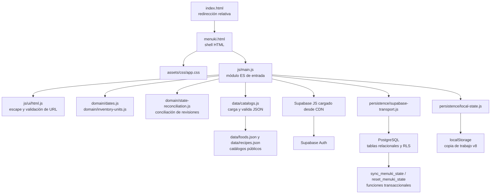

# Auditoría de arquitectura front-end y back-end

- **Fecha:** 13 de octubre de 2026
- **Alcance:** revisión estática del repositorio y del cliente web, junto con sus catálogos, documentación, migraciones y comprobación SQL.
- **Estado:** diagnóstico actualizado tras implementar las recomendaciones aceptadas y la conciliación automática entre dispositivos. Esta última y el acceso al historial de actividad están en la copia local de `dev`; la publicación y validación en navegador y la prueba RLS con dos cuentas siguen pendientes. El esquema de Supabase no ha cambiado.

## Resumen

Menuki es una aplicación estática en español publicada desde GitHub Pages. `index.html` redirige a `menuki.html`. El navegador carga los catálogos genéricos desde `data/`, guarda una copia de trabajo en `localStorage` y sincroniza los datos personales con Supabase Auth y tablas PostgreSQL protegidas con RLS.

La arquitectura funcional encaja con el producto actual: no hace falta introducir un servidor propio ni cambiar de proveedor. Antes de la primera etapa, `menuki.html` contenía alrededor de 276 kB, ocho bloques `<style>`, un bloque JavaScript clásico con 196 funciones declaradas y la conexión de autenticación, estado, sincronización, vistas y eventos. Ahora el HTML mide alrededor de 6,7 kB, los estilos están en `assets/css/app.css` y el código de entrada es `js/main.js`, un módulo ES de alrededor de 173 kB. La hoja se organiza por base, shell, controles y vistas; las reglas responsive quedan al final. Las plantillas JavaScript ya no generan atributos `style`: usan clases CSS, elementos `<progress>` y una imagen HTML para el hero. Ya existen módulos separados para fechas, unidades, catálogos, almacenamiento local, transporte de Supabase y codificación de HTML. El cliente Supabase está fijado a una versión exacta y hay pruebas de dominio/catálogos sin dependencias web. Las definiciones editables duplicadas de catálogos que permanecían en JavaScript se han eliminado. Vistas, gran parte de las reglas del dominio y la orquestación restante continúan en `main.js`, así que la separación es parcial e incremental.

**Recomendación:** conservar GitHub Pages, Supabase y los contratos actuales, y dividir gradualmente la interfaz en HTML, CSS y módulos JavaScript nativos. No recomiendo migrar ahora a React, Vue ni a TypeScript. Vite puede ser una etapa posterior si se necesita agrupar recursos o automatizar una compilación; las dependencias y pruebas actuales ya se pueden fijar sin añadir paso de compilación.

## Arquitectura observada



El navegador hace el renderizado, los cálculos de porciones, la propuesta de ciclos y la gestión de inventario. Supabase presta identidad, persistencia remota y sincronización. Los catálogos de alimentos y recetas son datos genéricos públicos; el estado personal se guarda por separado. El módulo `js/domain/dates.js` obtiene el día civil de `Europe/Madrid` y opera con fechas `YYYY-MM-DD` mediante portadores a medianoche UTC; esto evita que la zona del dispositivo o los cambios de horario de verano alteren la aritmética del calendario. Los timestamps permanecen como instantes ISO.

La primera etapa está registrada en [ADR-0013](decisions/0013-front-end-modules-and-madrid-dates.md), las fuentes canónicas en [ADR-0014](decisions/0014-canonical-data-sources.md), el paquete medio en [ADR-0015](decisions/0015-medium-priority-client-hardening.md), la limpieza de CSS/plantillas en [ADR-0016](decisions/0016-css-sections-and-template-presentation.md) y la conciliación automática e historial de actividad en [ADR-0017](decisions/0017-automatic-reconciliation-and-activity-history.md). El último paquete no modifica el esquema ni las RPC de Supabase. La interfaz, el resto de dominio y parte de la orquestación aún deben extraerse por etapas.

## Hallazgos y prioridades

| Prioridad | Hallazgo | Efecto | Propuesta | Estado actual |
| --- | --- | --- | --- | --- |
| Alta | La lógica de fechas usaba la zona horaria local del navegador. | Los requisitos fijan `Europe/Madrid`; un dispositivo configurado en otra zona podía considerar que un día empezaba o terminaba en un instante distinto. Esto afectaba al registro de comidas y sesiones y a la activación del siguiente ciclo. | Centralizar la fecha civil y la hora de Menuki en un módulo que aplique `Europe/Madrid` explícitamente. Mantener aritmética de fechas civiles y cubrir cambios de horario de verano. | Implementado en `js/domain/dates.js`. Pendiente validación publicada en navegador. |
| Alta | Presentación, dominio y persistencia compartían un único HTML y un ámbito global. | Un cambio de una vista podía afectar al estado, a los cálculos o a la sincronización. Costaba localizar responsabilidades, revisar regresiones y reutilizar lógica. | Extraer por etapas CSS y JavaScript; separar funciones de dominio puras de DOM, `localStorage` y Supabase. | CSS y entrada extraídos; fechas, unidades, catálogos y accesos de persistencia tienen módulos. `main.js` aún concentra UI, reglas y orquestación. |
| Media | Antes de la limpieza, los alimentos, recetas, compra y pesos por pieza aparecían tanto como literales en JavaScript como en los catálogos JSON. | Dos fuentes editables podían divergir en nombres, IDs, unidades, valores o formatos de compra. El menú fijo usa IDs de receta y sí cumple otra función. | Mantener los JSON como fuente canónica y derivar de ellos los modelos en memoria. Conservar estables los IDs y los JSON Schema. | Resuelto en esta etapa: se eliminaron los literales `FOOD`, `RECIPES`, `CATALOG` y `UNIT_GRAMS`; el menú fijo conserva solo referencias a recetas. Véase ADR-0014. |
| Media | El cliente de Supabase se cargaba desde `@supabase/supabase-js@2`, sin fijar una versión secundaria y de parche. | El recurso servido podía cambiar dentro de la versión principal y afectar a una app sin paso de compilación ni bloqueo de dependencias. | Fijar una versión exacta de la librería. Si más adelante se introduce una compilación, declarar la dependencia y conservar un archivo de bloqueo. La clave publishable que aparece en el navegador es apropiada para este modelo; no debe sustituirse por una clave secreta o `service_role`. | Implementado: `menuki.html` carga `@supabase/supabase-js@2.117.3`. |
| Media | No había una suite automatizada de front-end en el repositorio. | Los contratos de catálogos sí se validaban al cargar y existe una comprobación estructural SQL, pero eso no demuestra los recorridos de Auth, conciliación entre dispositivos, fechas ni uso en navegador. | Añadir comprobaciones pequeñas de dominio y validaciones de navegador para los recorridos sensibles. Ejecutar también la prueba RLS con dos cuentas que ya está pendiente en la documentación. | Implementado: `npm test` ejecuta nueve comprobaciones sin dependencias externas para fechas, unidades, catálogos y codificación HTML/URL. La conciliación automática, los recorridos publicados y RLS siguen pendientes de validar en vivo. |
| Media | Las vistas generan fragmentos HTML mediante concatenación y los asignan a `innerHTML`. Existe escape de HTML, pero la seguridad depende de aplicarlo en cada texto y atributo dinámico. | El contenido local o sincronizado puede proceder de copias importadas y catálogos editables; un escape omitido podría convertir datos en marcado ejecutable. La revisión estática no confirma una vulnerabilidad explotable concreta. | Definir una regla común para textos, atributos y URL; usar `textContent` o nodos DOM para valores variables cuando resulte sencillo. Revisar los usos de `innerHTML` durante la separación, sin quitar la validación de importación. | Implementado parcialmente: `js/ui/html.js` centraliza el escape y limita las URL a HTTPS y orígenes permitidos; se revisaron las vistas con contenido de catálogo/estado y se validan los IDs según el esquema. La estrategia de plantillas continúa y requiere revisión gradual. |
| Baja | Antes del refactor los estilos estaban en ocho bloques; también había estilos inline en plantillas. | Se hace difícil saber qué reglas pertenecen a una vista y qué cambios son globales; los estilos inline también limitan una futura política CSP estricta. | Ordenar la hoja por base, componentes, vistas y responsive; retirar estilos inline de forma gradual. | Implementado: `assets/css/app.css` está separado en secciones y concentra las reglas responsive al final. Se eliminaron los atributos `style` de las plantillas; los indicadores usan `<progress>` y la foto del hero usa un `` permitido por origen. |

Las prioridades reflejan riesgo de mantenimiento y ajuste a requisitos. Se implementaron las recomendaciones altas y los paquetes de prioridad media y baja. La publicación y las pruebas de sincronización entre dos cuentas y dispositivos continúan pendientes, según [la arquitectura](architecture.md), [la auditoría UX/UI](ux-ui-audit.md) y [la guía de Supabase](../supabase/README.md).

## Evaluación del back-end actual

La arquitectura de datos está alineada con las decisiones del proyecto y conviene conservarla durante la modularización:

- Supabase Auth administra las credenciales; el navegador solo usa la clave publishable.
- El esquema contiene trece tablas relacionales con políticas RLS vinculadas a `auth.uid()`.
- `sync_menuki_state` distribuye el JSON de transporte en tablas relacionales, comprueba `sync_revision` y se ejecuta dentro de una transacción. `reset_menuki_state` cubre el reemplazo confirmado del estado.
- Las funciones `SECURITY DEFINER` fijan `search_path`, derivan el propietario de la sesión y limitan su ejecución al rol autenticado.
- El cliente filtra las lecturas por `user_id`; ese filtro complementa RLS y no debe reemplazarla.
- `localStorage` es una copia de trabajo del navegador. El producto no mantiene una cola offline ni guarda datos personales en los catálogos públicos.

La principal tarea pendiente es operativa: la prueba SQL incluida confirma estructura, políticas y permisos, pero no prueba aislamiento en dos sesiones autenticadas. También están pendientes el recorrido real en GitHub Pages y la sincronización automática entre PC y móvil, incluida la conciliación de cambios independientes y simultáneos. Las migraciones se aplicaron manualmente desde SQL Editor y Supabase no registra esos archivos en su tabla de versiones. Si se incorpora Supabase CLI, primero hay que establecer con cuidado la correspondencia entre las siete migraciones ya aplicadas y el historial remoto; no se deben volver a ejecutar sobre el proyecto existente.

## Estructura actual y extracción propuesta

Esta es la estructura actual tras las tres etapas de modularización del cliente. Los módulos aún dentro de `main.js` son candidatos de extracción gradual, no archivos existentes:

```text
index.html                 # redirección relativa en la raíz
menuki.html                # shell HTML y puntos de montaje
assets/
  css/
    app.css                # base, componentes, vistas y reglas responsive
js/
  main.js                  # UI, dominio restante y composición; 173 kB aprox.
  ui/
    html.js                # escape de HTML y validación de URL
  data/catalogs.js         # carga y validación de foods.json / recipes.json
  domain/
    dates.js               # fechas civiles en Europe/Madrid
    inventory-units.js     # conversión receta/inventario
  persistence/
    local-state.js         # lectura y escritura de la copia de trabajo
    supabase-transport.js  # lecturas relacionales y llamadas RPC
  # siguientes candidatos: reglas de nutrición/planificador,
  # normalización del estado, vistas, eventos y orquestación de nube
tests/                     # suite integrada ejecutada con npm test
package.json               # script de pruebas; sin dependencias web
```

Los módulos de `domain/` deberían recibir datos como argumentos y devolver resultados sin tocar el DOM, el almacenamiento ni la red. `persistence/` debe ser responsable de guardar o recuperar datos. `ui/html.js` fija la regla compartida de codificación para las plantillas actuales; una futura capa `ui/` podrá mostrar el estado y enviar acciones a las reglas del dominio. `main.js` todavía inicia catálogos, Auth y vistas, y conserva una parte grande del comportamiento. Para la siguiente extracción no hace falta introducir una arquitectura compleja de componentes ni eliminar toda la variable compartida de estado en un solo cambio.

## Tecnología recomendada

| Área | Elección recomendada ahora | Cuándo reconsiderar |
| --- | --- | --- |
| Marcado | HTML semántico en `menuki.html`; conservar `index.html` en la raíz. | Si se añaden rutas o páginas independientes. |
| Estilos | CSS nativo; base, shell, componentes y vistas por secciones, con reglas responsive al final. | Un preprocesador solo si las reglas repetidas o el diseño de temas lo justifican. |
| Lógica | JavaScript moderno con módulos ES (`type="module"`) y APIs del navegador. | TypeScript si el dominio crece, trabajan varias personas o los contratos requieren más garantías estáticas. |
| Interfaz | Mantener el renderizado actual y extraer responsabilidades gradualmente. | React, Vue u otro framework si aparecen interfaces reutilizables complejas, rutas numerosas o estado compartido difícil de manejar. |
| Compilación | Supabase JS fijado a `2.117.3` por CDN; no hay compilación ni dependencias npm en producción. | Vite si aporta agrupación, optimización o un flujo de publicación repetible. |
| Persistencia | Supabase Auth, tablas relacionales, RLS y funciones actuales. | Añadir lógica de servidor solo ante una necesidad concreta que no deba confiarse al navegador. |

No recomiendo migrar ahora a un servidor Node, una aplicación de una sola página basada en framework ni una base de datos distinta. Añadirían publicación y operación nuevas sin resolver por sí solas la fuente principal de complejidad, que es la concentración de código.

## Secuencia de trabajo sugerida

1. **Etapas altas y paquetes medio y bajo implementados:** hoja CSS organizada, plantillas sin atributos `style`, entrada ES, módulos de fechas, unidades, catálogos y persistencia; fecha civil en `Europe/Madrid`; versión exacta del cliente Supabase; pruebas de dominio/catálogos/HTML y escape compartido. Preservar estado v8, importaciones v5-v8, catálogos 0.5.0, menú inicial, UI en español y sincronización.
2. **Validar en navegador antes de publicar:** carga de recursos, fecha actual, comidas y sesiones en los límites del día de Madrid, activación de ciclos, Auth, conciliación automática de cambios, borrado de sesiones, reinicio/restauración confirmados, navegación y compra; comprobar PC y móvil.
3. **Continuar la extracción gradualmente:** revisar primero las reglas de dominio (nutrición, planificador, inventario y normalización de estado), luego vistas/eventos y el resto de orquestación de nube. Evitar cambios de producto durante cada etapa y preservar los contratos existentes.
4. **Completar las comprobaciones operativas por separado:** prueba de aislamiento RLS con dos cuentas, publicación en GitHub Pages y validación en dispositivos reales.
5. **Evaluar herramienta de compilación con evidencia:** incorporar Vite o TypeScript solo si la separación muestra una necesidad concreta y dejar documentado el proceso de publicación desde `dev`.

## Límites de compatibilidad

- Mantener `index.html` y `menuki.html` en la raíz y usar referencias relativas compatibles con GitHub Pages.
- Mantener los JSON Schema, los IDs estables de alimentos y recetas, y la separación entre catálogos genéricos y datos personales.
- Conservar estado v8 e importación/restauración v5-v8; no añadir migraciones v1-v4.
- Mantener la sincronización autenticada, RLS, `auth.uid()`, el control `sync_revision`, las transacciones y la conciliación automática definida en ADR-0017.
- No introducir cola offline, sincronización manual de uso normal, notificaciones en segundo plano ni claves secretas en el navegador.
- Mantener las decisiones aceptadas del planificador, inventario y actividad. Las ideas aún propuestas siguen siendo preguntas abiertas.

## Alcance de la revisión

La línea base y este paquete se revisaron mediante lectura estática del código y la documentación, y `npm test` valida reglas seleccionadas. No se inspeccionó una sesión publicada en vivo. Las comprobaciones de Auth/sincronización en navegador, GitHub Pages y aislamiento RLS con dos cuentas siguen pendientes; las observaciones marcadas como propuestas describen trabajo futuro y no comportamiento implementado.
