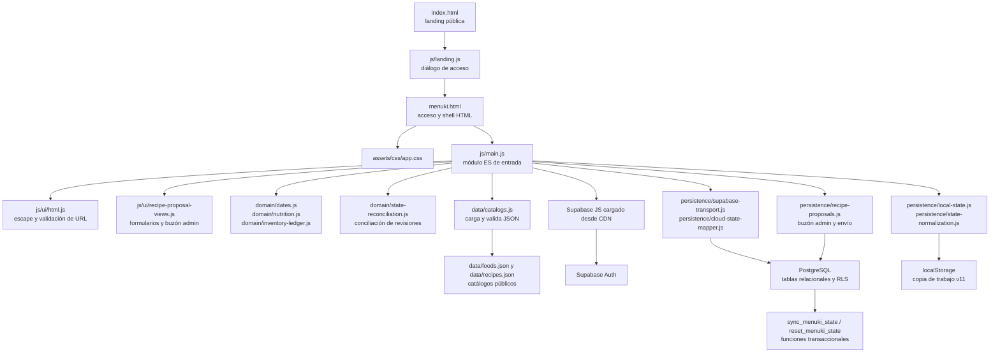

# Auditoría de arquitectura front-end y back-end

- **Fecha de auditoría inicial:** 13 de octubre de 2026
- **Actualización documental:** 23 de octubre de 2026 (confirmación del SQL del paquete 4; sin nueva auditoría funcional)
- **Alcance:** revisión estática del repositorio y del cliente web, junto con sus catálogos, documentación, migraciones y comprobación SQL.
- **Estado:** diagnóstico estático actualizado al código del repositorio y a la extracción incremental autorizada el 17/10/2026. La conciliación automática, el historial, la landing y el buzón admin están implementados. La corrección HTTP 409 está aplicada y resuelta según confirmación del administrador del 17/10/2026; la purga global sigue pendiente de confirmación. El paquete 7 valida posteriormente aislamiento personal con dos cuentas y sincronización desde dos orígenes de navegador; el cliente publicado y los dispositivos físicos siguen abiertos. Las observaciones sobre la arquitectura anterior se conservan como antecedentes.

Actualización del 23/10/2026: el propietario confirma que ejecutó `20261023120000_planning_preferences_and_setup.sql` en Supabase con Success y las siete consultas de diagnóstico en true. La migración y sus comprobaciones estructurales quedan registradas como aplicadas según su comunicación; en ese cierre no hubo inspección remota independiente ni validación funcional entre dispositivos. El [paquete 7](planner/package-7-integration.md) añade posteriormente 14 comprobaciones Auth/PostgREST con dos cuentas y recuperación/actualización automática entre dos orígenes de navegador, sin inspección administrativa del esquema. Los paquetes 1-4 incorporan cambios posteriores al diagnóstico inicial, incluido el estado v12; véase el [registro vigente del paquete 4](planner/package-4-persistence.md). Las referencias técnicas al estado v11 de esta auditoría describen sus antecedentes.

## Resumen

Menuki es una aplicación estática en español publicada desde GitHub Pages. `index.html` es la landing pública; abre el acceso en un diálogo y, al completar la autenticación, navega a `menuki.html`. Los enlaces relativos permiten abrir también el acceso independiente. El navegador carga los catálogos genéricos desde `data/`, guarda una copia de trabajo en `localStorage` y sincroniza los datos personales con Supabase Auth y tablas PostgreSQL protegidas con RLS.

La arquitectura funcional encaja con el producto actual: no hace falta introducir un servidor propio ni cambiar de proveedor. `menuki.html` es el shell, los estilos están en `assets/css/app.css` y la entrada es el módulo ES `js/main.js`. La hoja se organiza por base, shell, controles y vistas; las reglas responsive quedan al final. Las plantillas JavaScript no generan atributos `style`; usan clases CSS y elementos `<progress>`. Las fotos de platos se retiraron y se conserva la imagen de marca. Los catálogos JSON son la fuente editable única. Se han separado la normalización local v5-v11, los mapeos entre el estado de Menuki y el snapshot relacional, las reglas de nutrición y el libro de movimientos de despensa. `ui/recipe-proposal-views.js` concentra ahora los formularios y listados del buzón compartido con estado inyectado. La mayoría de vistas, los eventos, Auth y la coordinación del ciclo de sincronización permanecen en `main.js`. La separación sigue siendo incremental.

**Recomendación:** conservar GitHub Pages, Supabase y los contratos actuales, y dividir gradualmente la interfaz en HTML, CSS y módulos JavaScript nativos. No recomiendo migrar ahora a React, Vue ni a TypeScript. Vite puede ser una etapa posterior si se necesita agrupar recursos o automatizar una compilación; las dependencias y pruebas actuales ya se pueden fijar sin añadir paso de compilación.

## Arquitectura observada



El navegador hace el renderizado, los cálculos de porciones, la propuesta de ciclos y la gestión de inventario. Supabase presta identidad, persistencia remota y sincronización. Los catálogos de alimentos y recetas son datos genéricos públicos; el estado personal se guarda por separado. El módulo `js/domain/dates.js` obtiene el día civil de `Europe/Madrid` y opera con fechas `YYYY-MM-DD` mediante portadores a medianoche UTC; esto evita que la zona del dispositivo o los cambios de horario de verano alteren la aritmética del calendario. Los timestamps permanecen como instantes ISO.

El módulo de dominio también incluye conciliación, resumen de Inicio, compra por ciclo, conversión de unidades, cálculo nutricional y movimientos de inventario. `persistence/state-normalization.js` valida y convierte directamente estados locales v5-v11; `persistence/cloud-state-mapper.js` transforma el modelo de pantalla al contrato relacional y viceversa. El transporte mantiene las lecturas y RPC aparte, sin consultar la tabla histórica de faltantes. `persistence/recipe-proposals.js` separa las llamadas del buzón compartido. `ui/recipe-proposal-views.js` recibe el estado actual y utilidades de escape, y genera los formularios de propuesta y el listado administrativo; sus eventos y acciones remotas permanecen en `main.js`.

La primera etapa está registrada en [ADR-0013](decisions/0013-front-end-modules-and-madrid-dates.md), las fuentes canónicas en [ADR-0014](decisions/0014-canonical-data-sources.md), el paquete medio en [ADR-0015](decisions/0015-medium-priority-client-hardening.md), la limpieza de CSS/plantillas en [ADR-0016](decisions/0016-css-sections-and-template-presentation.md), la conciliación automática e historial en [ADR-0017](decisions/0017-automatic-reconciliation-and-activity-history.md), las reglas de dominio y persistencia en [ADR-0041](decisions/0041-client-domain-and-persistence-modules.md) y la extracción de vistas del buzón en [ADR-0042](decisions/0042-recipe-proposal-views.md). Esta refactorización no modifica el esquema ni las RPC de Supabase. La mayoría de vistas, los eventos y la coordinación completa de Auth/sincronización siguen en `main.js` y quedan para extracciones posteriores.

## Hallazgos y prioridades

| Prioridad | Hallazgo | Efecto | Propuesta | Estado actual |
| --- | --- | --- | --- | --- |
| Alta | La lógica de fechas usaba la zona horaria local del navegador. | Los requisitos fijan `Europe/Madrid`; un dispositivo configurado en otra zona podía considerar que un día empezaba o terminaba en un instante distinto. Esto afectaba al registro de comidas y sesiones y a la activación del siguiente ciclo. | Centralizar la fecha civil y la hora de Menuki en un módulo que aplique `Europe/Madrid` explícitamente. Mantener aritmética de fechas civiles y cubrir cambios de horario de verano. | Implementado en `js/domain/dates.js`. Pendiente validación publicada en navegador. |
| Alta | Presentación, dominio y persistencia compartían un único HTML y un ámbito global. | Un cambio de una vista podía afectar a otras áreas, a los cálculos o a la sincronización. Costaba localizar responsabilidades y revisar regresiones. | Extraer por etapas CSS y JavaScript; separar funciones de dominio puras de DOM, `localStorage` y Supabase. | Implementado parcialmente: los módulos de dominio y persistencia aíslan reglas y conversiones; `ui/recipe-proposal-views.js` separa las dos vistas del buzón. La mayoría de vistas, eventos y coordinación de Auth/sync siguen en `main.js` (224 kB) y quedan para etapas posteriores. |
| Media | Antes de la limpieza, los alimentos, recetas, compra y pesos por pieza aparecían tanto como literales en JavaScript como en los catálogos JSON. | Dos fuentes editables podían divergir en nombres, IDs, unidades, valores o formatos de compra. El menú fijo usa IDs de receta y sí cumple otra función. | Mantener los JSON como fuente canónica y derivar de ellos los modelos en memoria. Conservar estables los IDs y los JSON Schema. | Resuelto en esta etapa: se eliminaron los literales `FOOD`, `RECIPES`, `CATALOG` y `UNIT_GRAMS`; el menú fijo conserva solo referencias a recetas. Véase ADR-0014. |
| Media | El cliente de Supabase se cargaba desde `@supabase/supabase-js@2`, sin fijar una versión secundaria y de parche. | El recurso servido podía cambiar dentro de la versión principal y afectar a una app sin paso de compilación ni bloqueo de dependencias. | Fijar una versión exacta de la librería. Si más adelante se introduce una compilación, declarar la dependencia y conservar un archivo de bloqueo. La clave publishable que aparece en el navegador es apropiada para este modelo; no debe sustituirse por una clave secreta o `service_role`. | Implementado: `menuki.html` carga `@supabase/supabase-js@2.117.3`. |
| Media | No había una suite automatizada de front-end en el repositorio. | Los contratos de catálogos sí se validaban al cargar y existe una comprobación estructural SQL, pero eso no demuestra los recorridos de Auth, conciliación entre dispositivos, fechas ni uso en navegador. | Añadir comprobaciones pequeñas de dominio y validaciones de navegador para los recorridos sensibles. Ejecutar también la prueba RLS con dos cuentas que ya está pendiente en la documentación. | `npm test` ejecuta 35 pruebas sin dependencias de producción, con casos de conversión v5-v11, mapeo relacional, vistas del buzón, nutrición, inventario y conciliación. Auth, sincronización remota en vivo, RLS y recorridos entre dispositivos siguen pendientes de validar en vivo. |
| Media | Las vistas generan fragmentos HTML mediante concatenación y los asignan a `innerHTML`. Existe escape de HTML, pero la seguridad depende de aplicarlo en cada texto y atributo dinámico. | El contenido local o sincronizado puede proceder de instalaciones existentes, formularios y catálogos editables; un escape omitido podría convertir datos en marcado ejecutable. La revisión estática no confirma una vulnerabilidad explotable concreta. | Definir una regla común para textos, atributos y URL; usar `textContent` o nodos DOM para valores variables cuando resulte sencillo. Revisar los usos de `innerHTML` durante la separación, sin quitar la validación del estado local y remoto. | Implementado parcialmente: `js/ui/html.js` centraliza el escape y limita las URL a HTTPS y orígenes permitidos; se revisaron las vistas con contenido de catálogo/estado y se validan los IDs según el esquema. La estrategia de plantillas continúa y requiere revisión gradual. |
| Baja | Antes del refactor los estilos estaban en ocho bloques; también había estilos inline en plantillas. | Se hace difícil saber qué reglas pertenecen a una vista y qué cambios son globales; los estilos inline también limitan una futura política CSP estricta. | Ordenar la hoja por base, componentes, vistas y responsive; retirar estilos inline de forma gradual. | Implementado: `assets/css/app.css` está separado en secciones y concentra las reglas responsive al final. Se eliminaron los atributos `style` de las plantillas; los indicadores usan `<progress>`. Las fotografías de recetas se retiraron después mediante ADR-0018. |

Las prioridades reflejan riesgo de mantenimiento y ajuste a requisitos. Se implementaron las extracciones de dominio y persistencia descritas en ADR-0041 y la extracción de vistas del buzón descrita en ADR-0042, pero no se ha terminado la modularización: la mayoría de vistas, los eventos y la coordinación de Auth/sync continúan en `main.js`. La validación publicada, las pruebas de sincronización entre dispositivos y el aislamiento RLS continúan pendientes, según [la arquitectura](architecture.md), [la auditoría UX/UI](ux-ui-audit.md) y [la guía de Supabase](../supabase/README.md).

## Evaluación del back-end actual

La arquitectura de datos está alineada con las decisiones del proyecto y conviene conservarla durante la modularización:

- Supabase Auth administra las credenciales; el navegador solo usa la clave publishable.
- El esquema remoto tiene catorce tablas personales con RLS por `auth.uid()`, incluida una tabla histórica de faltantes que el cliente ya no usa. El propietario confirma que `20261018120000_retire_meal_shortfalls.sql` se aplicó y verificó en SQL Editor el 22/10/2026: no quedan filas, el disparador habilitado descarta inserciones y actualizaciones antiguas, y el rol `authenticated` no tiene permisos directos de inserción, actualización ni borrado. La tabla sigue en el esquema por compatibilidad; otras cuatro tablas cubren el buzón compartido y la lista privada de administradores.
- `sync_menuki_state` distribuye el JSON de transporte en tablas relacionales, comprueba `sync_revision` y se ejecuta dentro de una transacción. `reset_menuki_state` cubre el reemplazo confirmado del estado.
- Las funciones `SECURITY DEFINER` fijan `search_path`, derivan el propietario de la sesión y limitan su ejecución al rol autenticado.
- El cliente filtra las lecturas por `user_id`; ese filtro complementa RLS y no debe reemplazarla.
- `localStorage` es una copia de trabajo del navegador. El producto no mantiene una cola offline ni guarda datos personales en los catálogos públicos.

La corrección HTTP 409 ya está aplicada y resuelta según confirmación del administrador comunicada el 17/10/2026. El propietario confirma que la migración inicial de faltantes se ejecutó el 17/10 y que la migración de retirada `20261018120000_retire_meal_shortfalls.sql` se aplicó y sus efectos se comprobaron manualmente en SQL Editor el 22/10/2026. Sigue pendiente confirmar la corrección de purga global, ejecutar las comprobaciones SQL vigentes y probar el aislamiento en dos sesiones autenticadas. También están pendientes el recorrido real en GitHub Pages y la sincronización automática entre PC y móvil, incluida la conciliación de cambios independientes y simultáneos. Las migraciones se aplicaron manualmente desde SQL Editor y Supabase no registra esos archivos en su tabla de versiones. Si se incorpora Supabase CLI, primero hay que establecer con cuidado la correspondencia entre las migraciones confirmadas como aplicadas, las definiciones reales y el historial remoto; no se deben volver a ejecutar sobre el proyecto existente.

## Estructura actual y extracción propuesta

Esta es la estructura actual tras las extracciones incrementales del cliente. Los módulos aún dentro de `main.js` son candidatos de extracción gradual, no archivos existentes:

```text
index.html                 # landing pública en la raíz
menuki.html                # shell HTML y puntos de montaje
assets/
  css/
    app.css                # base, componentes, vistas y reglas responsive
js/
  main.js                  # vistas restantes, eventos, Auth y composición/orquestación
  landing.js               # diálogo de acceso e interacciones públicas
  ui/
    html.js                # escape de HTML y validación de URL
    legal-dialog.js        # lectura compartida de borradores legales
    recipe-proposal-views.js # vistas de propuesta e inbox admin
  data/catalogs.js         # carga y validación de foods.json / recipes.json
  domain/
    dates.js               # fechas civiles en Europe/Madrid
    nutrition.js           # objetivos, macros y ajuste de cantidades
    inventory-ledger.js    # movimientos idempotentes y saldo no negativo
    inventory-units.js     # conversión receta/inventario
    state-reconciliation.js # conciliación entre dispositivos
    cycle-shopping.js      # ventanas y ámbito de compra
    dashboard.js           # resumen semanal y del ciclo
    recipe-proposal-export.js # paquete admin sin identidad
  persistence/
    local-state.js         # lectura y escritura de la copia de trabajo
    state-normalization.js # migraciones y validación local v5-v11
    cloud-state-mapper.js  # conversión entre estado y snapshot relacional
    supabase-transport.js  # lecturas relacionales y llamadas RPC
    recipe-proposals.js    # envío y mantenimiento del buzón
  # siguientes candidatos: otras vistas, eventos y coordinación de nube
tests/                     # suite integrada ejecutada con npm test
package.json               # script de pruebas; sin dependencias web
```

Los módulos de `domain/` reciben reglas y datos, y no acceden al DOM, al almacenamiento ni a la red. `persistence/` contiene la conversión de formatos y las fronteras de almacenamiento/transporte. `ui/recipe-proposal-views.js` recibe los borradores y el estado del buzón mediante una función `getState`; no accede al DOM ni llama a Supabase. `main.js` todavía inicia catálogos, Auth y las demás vistas, registra eventos y coordina la sincronización. La siguiente extracción debe separar otras plantillas y acciones por área, dejando `main.js` como composición, con pruebas de cada contrato antes de mover el coordinador remoto.

## Tecnología recomendada

| Área | Elección recomendada ahora | Cuándo reconsiderar |
| --- | --- | --- |
| Marcado | HTML semántico en `menuki.html`; conservar `index.html` en la raíz. | Si se añaden rutas o páginas independientes. |
| Estilos | CSS nativo; base, shell, componentes y vistas por secciones, con reglas responsive al final. | Un preprocesador solo si las reglas repetidas o el diseño de temas lo justifican. |
| Lógica | JavaScript moderno con módulos ES (`type="module"`) y APIs del navegador. | TypeScript si el dominio crece, trabajan varias personas o los contratos requieren más garantías estáticas. |
| Interfaz | Mantener el renderizado actual y extraer responsabilidades gradualmente. | React, Vue u otro framework si aparecen interfaces reutilizables complejas, rutas numerosas o estado compartido difícil de manejar. |
| Compilación | Supabase JS fijado a `2.117.3` por CDN; no hay compilación ni dependencias npm en producción. | Vite si aporta agrupación, optimización o un flujo de publicación repetible. |
| Persistencia | Supabase Auth, tablas relacionales, RLS y funciones actuales. | Añadir lógica de servidor solo ante una necesidad concreta que no deba confiarse al navegador. |

No recomiendo migrar ahora a un servidor Node, una aplicación de una sola página basada en framework ni una base de datos distinta. Añadirían publicación y operación nuevas sin resolver por sí solas la fuente principal de complejidad, que es la concentración de código.

## Secuencia de trabajo sugerida

1. **Extracción de dominio y persistencia aplicada localmente:** normalización v5-v11, mapeo estado/snapshot relacional, nutrición y movimientos de despensa; pruebas directas de estos contratos, conciliación y transporte. Se preservan catálogos, menú inicial y comportamiento de sync.
2. **Siguiente refactor:** la vista de propuesta y el inbox administrativo ya están en `ui/recipe-proposal-views.js`. Continuar con las demás vistas y después separar eventos por área; conservar en `main.js` el arranque y la composición. Encapsular la coordinación de sincronización al final, sin cambiar sus reintentos, conflictos 409, metadatos o conciliación.
3. **Validación posterior:** carga de recursos, fechas de Madrid, comidas y reversos, Auth, reconciliación, reinicio confirmado, navegación y compra en escritorio y móvil. La carga local sin autenticación ya se verificó; el paquete 7 añade flujos autenticados contra Supabase real en dos orígenes locales de navegador. Después, el propietario confirmó que la versión actual funciona en PC y móvil; no se repitió desde el agente la auditoría exhaustiva de todos los escenarios.
4. **Completar las comprobaciones operativas por separado:** aislamiento RLS con dos cuentas, publicación en GitHub Pages y sincronización entre dispositivos. No se afirma validación de Supabase en vivo a partir de las pruebas locales.
5. **Evaluar herramienta de compilación con evidencia:** incorporar Vite o TypeScript solo si la separación muestra una necesidad concreta y documentar el flujo de publicación desde `dev`.

## Límites de compatibilidad

- Mantener `index.html` y `menuki.html` en la raíz y usar referencias relativas compatibles con GitHub Pages.
- Mantener los JSON Schema, los IDs estables de alimentos y recetas, y la separación entre catálogos genéricos y datos personales.
- Conservar estado v11 y la migración local v5-v11; no ofrecer restauración personal JSON ni añadir migraciones v1-v4.
- Mantener la sincronización autenticada, RLS, `auth.uid()`, el control `sync_revision`, las transacciones y la conciliación automática definida en ADR-0017.
- No introducir cola offline, sincronización manual de uso normal, notificaciones en segundo plano ni claves secretas en el navegador.
- Mantener las decisiones aceptadas del planificador, inventario y actividad. Las ideas aún propuestas siguen siendo preguntas abiertas.

## Alcance de la revisión

La línea base y este paquete se revisaron mediante lectura estática del código y la documentación, y `npm test` valida reglas seleccionadas. Esta auditoría estática no acreditaba Auth ni RLS. El paquete 7 aporta después comprobaciones alojadas y navegador con dos cuentas; el propietario confirma el funcionamiento actual en PC y móvil. Las observaciones marcadas como propuestas describen trabajo futuro y no comportamiento implementado.
