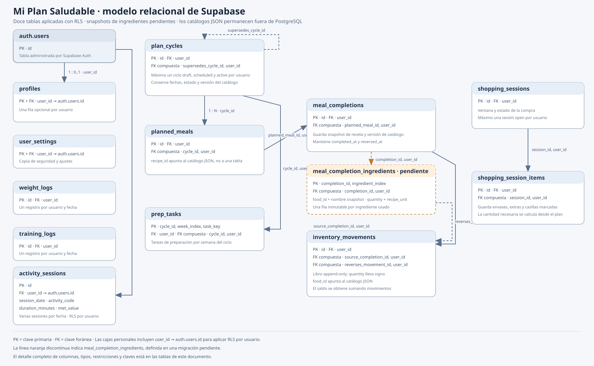

# Modelo de datos de Supabase

Última revisión documental: 22 de octubre de 2026. El modelo documenta catorce tablas personales y cuatro tablas compartidas del buzón. El propietario confirma que `20261017100000_nonnegative_inventory_shortfalls.sql` y la corrección `20261017110000_fix_zero_quantity_meal_constraint.sql` se aplicaron en Supabase el 17/10/2026; esta última resolvió el error `23514` al eliminar la regla obsoleta que rechazaba movimientos meal con cantidad cero. La tabla `meal_completion_shortfalls` queda retirada por ADR-0043; el propietario confirmó el 22/10/2026 que `20261018120000_retire_meal_shortfalls.sql` se aplicó y que las comprobaciones en SQL Editor mostraron cero filas, el disparador activo que descarta escrituras antiguas y ausencia de permisos directos de escritura para `authenticated`. También informa que `20261013160000_recipe_proposal_inbox.sql` se aplicó; la corrección HTTP 409 está aplicada y resuelta según confirmación del administrador del 17/10/2026. Las migraciones SQL son la fuente de verdad si hubiera diferencias con esta documentación.

El HTML y Supabase Auth están integrados en el repositorio; las siete migraciones iniciales están aplicadas al proyecto. La novena, la décima y la asignación admin se consideran aplicadas según el propietario; la corrección HTTP 409 de la octava, `20261013120000_menuki_sync_conflict_http_409.sql`, está aplicada y resuelta según el administrador (17/10/2026). La app sincroniza mediante una función transaccional con las tablas normalizadas. Quedan por validar el flujo completo del cliente publicado entre dispositivos, el buzón y el aislamiento con dos cuentas autenticadas. La corrección de purga global sigue pendiente de confirmación. Esta revisión no ha consultado el proyecto remoto; la aplicación de las migraciones y la comprobación de la retirada de faltantes se registran según la confirmación del propietario.

## Diagrama entidad-relación

El diagrama muestra las catorce tablas personales, incluida la tabla heredada `meal_completion_shortfalls` (retirada; limpieza aplicada y comprobada según el propietario el 22/10/2026), y, con borde discontinuo, las cuatro tablas compartidas del buzón creadas por la novena migración (aplicada según el propietario). `auth.users` pertenece a Supabase Auth. El detalle completo de columnas aparece debajo.

PK significa clave primaria y FK significa clave foránea. Las tablas de la aplicación incluyen user_id para aislar sus filas por propietario. Las líneas discontinuas muestran referencias opcionales del modelo.

## Convenciones

- Todos los registros personales pertenecen a una fila de auth.users mediante user_id. La política RLS compara ese valor con auth.uid().
- Las referencias a ciclo, comida y sesión suelen incluir también user_id en una FK compuesta. Así se impide relacionar filas de usuarios distintos.
- TIMESTAMPTZ almacena marcas temporales con zona horaria. Los campos DATE representan fechas de calendario sin hora.
- Los campos updated_at tienen DEFAULT now() al insertar. No hay triggers que los actualicen automáticamente en cada modificación.
- Los IDs food_id y recipe_id son identificadores de los catálogos JSON. No tienen FK SQL porque esos catálogos no se duplican en PostgreSQL.
- Las cantidades de inventario y compra usan la unidad `unit` del alimento (g, ml o ud); las recetas usan `recipeUnit`. En el inventario, quantity lleva signo: entradas positivas y consumos/salidas negativas. Las porciones de fruta entera usan `ud` en receta e inventario. El pan de molde usa rebanadas en receta y gramos en movimientos/compra, con conversión aproximada de 25 g por rebanada. Las verduras que se trocean siguen en gramos de receta y pueden comprarse/guardarse por unidad.
- La tabla de movimientos es append-only para el rol de la aplicación: puede leer e insertar, pero no actualizar ni borrar.
- `training_logs` y `profiles.training_bonus_kcal` son heredados; el cálculo actual usa `activity_sessions`.

## Tablas y columnas

### auth.users

Tabla externa administrada por Supabase Auth. La aplicación no la crea ni la modifica mediante estas migraciones.
El correo y la contraseña se administran aquí; no se copian a `public.profiles`.

| Columna | Tipo | Nulable | Clave o regla |
| --- | --- | --- | --- |
| id | uuid | No | PK de Supabase Auth; referenciada por user_id en las tablas personales. |

### profiles

Una fila opcional por usuario con los parámetros usados por el cálculo nutricional.

| Columna | Tipo | Nulable | Clave o regla |
| --- | --- | --- | --- |
| user_id | uuid | No | PK y FK → auth.users.id; ON DELETE CASCADE. |
| sex | text | No | DEFAULT 'manual'; male, female o manual. |
| age | smallint | No | Entre 18 y 95. |
| height_cm | numeric(5,1) | No | Entre 125 y 220 cm. |
| reference_weight_kg | numeric(5,1) | No | Entre 35 y 250 kg. |
| activity_level | text | No | DEFAULT 'sedentary'; very_sedentary, sedentary, light, moderate, intense o very_intense. |
| training_bonus_kcal | smallint | No | DEFAULT 0; entre 0 y 400. Campo heredado, ya no usado por el cálculo local. |
| goal | text | No | DEFAULT 'maintain'; maintain, recomp, fat_loss o muscle_gain. |
| injury_recovery | boolean | No | DEFAULT false. |
| auto_portions | boolean | No | DEFAULT true. |
| follow_weight | boolean | No | DEFAULT false. |
| manual_rmr_kcal | smallint | No | DEFAULT 1600; entre 800 y 3500. |
| created_at | timestamptz | No | DEFAULT now(). |
| updated_at | timestamptz | No | DEFAULT now(); la base no lo actualiza automáticamente. |
| profile_confirmed | boolean | No | DEFAULT false; el usuario revisó y guardó el perfil usado para los cálculos. |

### plan_cycles

Cada fila representa un menú de tres semanas, incluida su versión del catálogo. Puede enlazarse con el ciclo que sustituye.

| Columna | Tipo | Nulable | Clave o regla |
| --- | --- | --- | --- |
| id | uuid | No | PK; DEFAULT gen_random_uuid(). También participa en UNIQUE (id, user_id). |
| user_id | uuid | No | FK → auth.users.id; ON DELETE CASCADE. |
| start_date | date | No | Primer día del ciclo. |
| status | text | No | draft, scheduled, active, archived o superseded. |
| catalog_version | text | No | Versión de foods.json y recipes.json usada por el ciclo. |
| generated_at | timestamptz | Sí | Momento de generación, si se conoce. |
| confirmed_at | timestamptz | Sí | Momento de confirmación, si se conoce. |
| recovery_focus | boolean | No | DEFAULT false; indica el enfoque cualitativo de recuperación ósea del ciclo. |
| archived_at | timestamptz | Sí | Momento en que el ciclo se archivó. |
| supersedes_cycle_id | uuid | Sí | Junto con user_id, FK → plan_cycles (id, user_id); ON DELETE RESTRICT. |
| created_at | timestamptz | No | DEFAULT now(). |

Índices únicos parciales: como máximo un ciclo draft, scheduled y active por usuario. También hay un índice por user_id y start_date descendente.

### planned_meals

Una fila representa un hueco de comida de un ciclo: fecha, posición diaria y receta asignada.

| Columna | Tipo | Nulable | Clave o regla |
| --- | --- | --- | --- |
| id | uuid | No | PK; DEFAULT gen_random_uuid(). También participa en UNIQUE (id, user_id). |
| user_id | uuid | No | FK → auth.users.id; ON DELETE CASCADE. |
| cycle_id | uuid | No | Junto con user_id, FK → plan_cycles (id, user_id); ON DELETE CASCADE. |
| meal_date | date | No | Fecha prevista. |
| slot | smallint | No | Entre 0 y 4. |
| recipe_id | text | No | ID estable de recipes.json; no es una FK SQL. |
| is_locked | boolean | No | DEFAULT false. |
| created_at | timestamptz | No | DEFAULT now(). |

Restricción UNIQUE (cycle_id, meal_date, slot): no puede haber dos recetas en el mismo hueco del ciclo.

### meal_completions

Conserva el evento de completar una comida, el ID de receta usado en ese momento y cuándo se revirtió. Los registros no se borran al desmarcar una comida. Las cantidades por ingrediente se guardan en `meal_completion_ingredients`; los movimientos vinculados registran el consumo en la unidad de inventario del alimento.

| Columna | Tipo | Nulable | Clave o regla |
| --- | --- | --- | --- |
| id | uuid | No | PK; DEFAULT gen_random_uuid(). También participa en UNIQUE (id, user_id). |
| user_id | uuid | No | FK → auth.users.id; ON DELETE CASCADE. |
| planned_meal_id | uuid | No | Junto con user_id, FK → planned_meals (id, user_id); ON DELETE RESTRICT. |
| recipe_id_snapshot | text | No | ID de receta conservado como snapshot. |
| catalog_version | text | No | Versión del catálogo usada al registrar la comida. |
| operation_id | text | No | UNIQUE junto con user_id para evitar duplicar el mismo evento. |
| completed_at | timestamptz | No | DEFAULT now(). |
| reversed_at | timestamptz | Sí | Nulo mientras el evento no se haya revertido. |
| created_at | timestamptz | No | DEFAULT now(). |

Un índice único parcial permite como máximo una finalización no revertida por comida planificada y usuario. `sync_menuki_state` inserta idempotentemente los eventos, sus snapshots y movimientos dentro de una transacción, y propaga la marca de reversión.

### meal_completion_ingredients — aplicada

Guarda una fila inmutable por ingrediente de una comida completada. Conserva la cantidad realmente registrada en la unidad de receta, separada del movimiento de inventario que descuenta el stock en la unidad de despensa. Así, una receta puede guardar `250 g` de brócoli mientras el movimiento de inventario guarda, por ejemplo, `-0,63 ud`.

| Columna | Tipo | Nulable | Clave o regla |
| --- | --- | --- | --- |
| completion_id | uuid | No | PK compuesta con ingredient_index; junto con user_id, FK → meal_completions (id, user_id); ON DELETE CASCADE. |
| ingredient_index | smallint | No | PK compuesta; índice desde cero según el orden de ingredientes de la receta; no negativo. |
| user_id | uuid | No | FK → auth.users.id; ON DELETE CASCADE; RLS compara con auth.uid(). |
| food_id | text | No | ID estable de foods.json; no es una FK SQL. |
| ingredient_name_snapshot | text | No | Nombre mostrado al registrar, entre 1 y 160 caracteres tras recortar espacios. |
| quantity | numeric(14,4) | No | Cantidad positiva realmente usada, expresada en recipe_unit. |
| recipe_unit | text | No | g, ml o ud. |
| created_at | timestamptz | No | DEFAULT now(). |

La tabla permite varias líneas para un mismo food_id, porque conserva el índice de línea original. RLS permite SELECT e INSERT de filas propias; el rol de la aplicación no recibe UPDATE ni DELETE. La reversión de la comida conserva estos snapshots y crea movimientos inversos; no los modifica. No hay caducidad temporal ni tarea de purga; se conservan mientras exista la comida completada y la cuenta. El tamaño total y por tabla se revisará conforme se incorporen usuarios, con una revisión al acercarse a 350 MB.

### meal_completion_shortfalls

Tabla heredada, fuera del modelo activo de la aplicación. ADR-0043 elimina la necesidad de registrar cuánto supuestamente faltaba al completar una comida. El cliente ya no la consulta ni la envía. El propietario confirmó el 22/10/2026 que `20261018120000_retire_meal_shortfalls.sql` se aplicó: las filas históricas se eliminaron y un disparador `BEFORE INSERT OR UPDATE` devuelve `NULL` para descartar las escrituras de versiones antiguas del RPC. La tabla permanece vacía por compatibilidad. Las consultas del propietario también confirmaron que `authenticated` no tiene permisos directos de inserción, actualización ni borrado; este estado se registra como comprobación comunicada por el propietario, no como inspección independiente desde el repositorio.

| Columna | Tipo | Nulable | Clave o regla |
| --- | --- | --- | --- |
| completion_id | uuid | No | PK compuesta; FK compuesta a meal_completions (id, user_id), ON DELETE CASCADE. |
| user_id | uuid | No | FK → auth.users.id; ON DELETE CASCADE. |
| food_id | text | No | ID del catálogo JSON; no es una FK SQL. |
| quantity | numeric(14,4) | No | Cantidad positiva de una fila histórica; no se generarán nuevas filas tras aplicar la migración de retirada. |
| unit | text | No | g, ml o ud. |
| created_at | timestamptz | No | DEFAULT now(). |
### inventory_movements

Libro de entradas y salidas. El saldo de cada alimento se calcula sumando quantity y nunca puede ser negativo. Los movimientos de comida descuentan solo el saldo disponible; el cliente conserva el consumo total en la comida, sin guardar ni mostrar diferencias por falta de saldo.

No hay una tabla purchases separada: cada línea comprada se representa como un movimiento con movement_kind = purchase y quantity positiva.

| Columna | Tipo | Nulable | Clave o regla |
| --- | --- | --- | --- |
| id | uuid | No | PK; DEFAULT gen_random_uuid(). También participa en UNIQUE (id, user_id). |
| user_id | uuid | No | FK → auth.users.id; ON DELETE CASCADE. |
| food_id | text | No | ID estable de foods.json; no es una FK SQL. |
| quantity | numeric(14,4) | No | Debe ser distinta de cero; el signo representa entrada o salida. |
| unit | text | No | g, ml o ud. |
| movement_kind | text | No | opening, purchase, meal, adjustment, waste o reversal. |
| operation_id | text | No | UNIQUE junto con user_id para idempotencia. |
| operation_group_id | text | Sí | Agrupa líneas de una misma operación. |
| source_completion_id | uuid | Sí | Junto con user_id, FK → meal_completions (id, user_id); ON DELETE RESTRICT. |
| reverses_movement_id | uuid | Sí | Junto con user_id, FK → inventory_movements (id, user_id); ON DELETE RESTRICT. |
| shortfall_quantity | numeric(14,4) | No | DEFAULT 0; campo heredado. Los valores históricos se conservan para calcular correctamente las reversiones antiguas; los movimientos nuevos usan cero. |
| note | text | Sí | Nota opcional. |
| created_at | timestamptz | No | DEFAULT now(). |

Reglas principales: meal admite quantity negativa o cero y exige source_completion_id; un movimiento meal de cero es un marcador idempotente que no cambia el saldo. Purchase y opening requieren quantity positiva; waste requiere quantity negativa; reversal debe tener reverses_movement_id y los demás tipos no. Un movimiento solo puede tener un reverso enlazado. Los movimientos meal registran solo la salida cubierta por el saldo; no se registra una cantidad faltante.

### weight_logs

| Columna | Tipo | Nulable | Clave o regla |
| --- | --- | --- | --- |
| id | uuid | No | PK; DEFAULT gen_random_uuid(). |
| user_id | uuid | No | FK → auth.users.id; ON DELETE CASCADE. |
| measured_on | date | No | UNIQUE junto con user_id: un peso diario por usuario. |
| weight_kg | numeric(5,2) | No | Entre 30 y 250 kg. |
| created_at | timestamptz | No | DEFAULT now(). |

### training_logs

Tabla heredada del diseño inicial; permite como máximo una marca por usuario y fecha. No almacena tipo ni duración y no se usa en el cálculo local actual.

| Columna | Tipo | Nulable | Clave o regla |
| --- | --- | --- | --- |
| id | uuid | No | PK; DEFAULT gen_random_uuid(). |
| user_id | uuid | No | FK → auth.users.id; ON DELETE CASCADE. |
| training_date | date | No | UNIQUE junto con user_id: un registro por fecha y usuario. |
| created_at | timestamptz | No | DEFAULT now(). |

### activity_sessions — aplicada

Registra sesiones ya realizadas, permite varias por usuario y fecha y conserva la actividad/MET usada como snapshot.

| Columna | Tipo | Nulable | Clave o regla |
| --- | --- | --- | --- |
| id | uuid | No | PK; DEFAULT gen_random_uuid(). |
| user_id | uuid | No | FK → auth.users.id; ON DELETE CASCADE. |
| session_date | date | No | Fecha local en que ocurrió la sesión. |
| activity_code | text | No | Código de actividad; longitud recortada entre 1 y 80 caracteres. |
| duration_minutes | smallint | No | Entre 1 y 600 minutos. |
| met_value | numeric(4,2) | No | MET snapshot, entre 1 y 20. |
| created_at | timestamptz | No | DEFAULT now(). |
| client_id | text | Sí | Identificador estable del cliente; UNIQUE junto con user_id para sincronización idempotente. |

Índices: `(user_id, session_date DESC, created_at DESC)` y `(user_id, client_id)` único. RLS permite al usuario autenticado seleccionar, insertar y borrar solo sus filas; no se concede UPDATE. Para corregir una sesión se elimina y se vuelve a insertar.

### prep_tasks

| Columna | Tipo | Nulable | Clave o regla |
| --- | --- | --- | --- |
| user_id | uuid | No | FK → auth.users.id; ON DELETE CASCADE. |
| cycle_id | uuid | No | Junto con user_id, FK → plan_cycles (id, user_id); ON DELETE CASCADE. |
| week_index | smallint | No | Entre 0 y 2. |
| task_key | text | No | Clave estable de la tarea. |
| is_completed | boolean | No | DEFAULT false. |
| updated_at | timestamptz | No | DEFAULT now(); no se actualiza automáticamente. |

PK compuesta: (cycle_id, week_index, task_key).

### shopping_sessions

Representa la ventana de una lista de compra y su estado.

| Columna | Tipo | Nulable | Clave o regla |
| --- | --- | --- | --- |
| id | uuid | No | PK; DEFAULT gen_random_uuid(). También participa en UNIQUE (id, user_id). |
| user_id | uuid | No | FK → auth.users.id; ON DELETE CASCADE. |
| window_key | text | No | Identificador de la ventana de compra. |
| starts_on | date | No | Inicio de la ventana. |
| ends_on | date | No | Debe ser igual o posterior a starts_on. |
| status | text | No | DEFAULT 'open'; open, completed o cancelled. |
| created_at | timestamptz | No | DEFAULT now(). |

Un índice único parcial permite como máximo una sesión open por usuario.

### shopping_session_items

Guarda la selección, envase y estado marcado de cada artículo de la compra. La cantidad necesaria se deriva del menú y de la despensa; no se duplica aquí.

| Columna | Tipo | Nulable | Clave o regla |
| --- | --- | --- | --- |
| id | uuid | No | PK; DEFAULT gen_random_uuid(). |
| user_id | uuid | No | FK → auth.users.id; ON DELETE CASCADE. |
| session_id | uuid | No | Junto con user_id, FK → shopping_sessions (id, user_id); ON DELETE CASCADE. |
| item_key | text | No | UNIQUE junto con session_id. |
| food_id | text | No | ID estable de foods.json; no es una FK SQL. |
| item_kind | text | No | planned o extra. |
| is_checked | boolean | No | DEFAULT false. |
| package_count | numeric(12,3) | No | DEFAULT 0; debe ser mayor o igual que cero. |
| package_size | numeric(14,4) | No | Debe ser mayor que cero. |
| unit | text | No | g, ml o ud. |
| updated_at | timestamptz | No | DEFAULT now(); no se actualiza automáticamente. |

### user_settings

| Columna | Tipo | Nulable | Clave o regla |
| --- | --- | --- | --- |
| user_id | uuid | No | PK y FK → auth.users.id; ON DELETE CASCADE. |
| last_backup_at | timestamptz | Sí | Fecha de la última copia anotada. |
| state_initialized_at | timestamptz | Sí | Se fija tras la primera sincronización completa para impedir que un dispositivo vacío importe sobre datos existentes. |
| last_synced_at | timestamptz | Sí | Última confirmación de sincronización. |
| sync_revision | bigint | No | DEFAULT 0; contador de control de concurrencia que rechaza escrituras con revisión desactualizada. |
| updated_at | timestamptz | No | DEFAULT now(); no se actualiza automáticamente. |

### menuki_admins — migración aplicada según el propietario

Lista privada de cuentas a las que el propietario concedió el rol administrativo. No tiene permisos de acceso directo para los roles `anon` ni `authenticated`; las funciones de seguridad comprueban la pertenencia.

| Columna | Tipo | Nulable | Clave o regla |
| --- | --- | --- | --- |
| user_id | uuid | No | PK y FK → auth.users.id; ON DELETE CASCADE. |
| granted_at | timestamptz | No | DEFAULT now(); momento de asignación. |

### recipe_proposals — migración aplicada según el propietario

Cabecera del buzón compartido. Guarda la idea original, no la receta nutricional final. No se guardan cantidades, kcal ni nutrientes; el buzón se elimina globalmente después de que el administrador haya publicado las recetas en los JSON.

| Columna | Tipo | Nulable | Clave o regla |
| --- | --- | --- | --- |
| id | uuid | No | PK; DEFAULT gen_random_uuid(). |
| submitter_id | uuid | No | FK → auth.users.id; ON DELETE CASCADE. |
| client_id | uuid | No | Identificador de idempotencia generado por el cliente; UNIQUE junto con submitter_id. |
| meal_type | text | No | CHECK: desayuno, comida, snack o cena. |
| recipe_name | text | No | Entre 1 y 120 caracteres tras recortar espacios. |
| created_at | timestamptz | No | DEFAULT now(); índice descendente para el buzón. |

### recipe_proposal_ingredients — migración aplicada según el propietario

Ingredientes en texto libre, conservados en el orden enviado. El límite de 30 filas y 160 caracteres por ingrediente se valida en la RPC y en las restricciones de tabla.

| Columna | Tipo | Nulable | Clave o regla |
| --- | --- | --- | --- |
| proposal_id | uuid | No | PK compuesta con position; FK → recipe_proposals.id; ON DELETE CASCADE. |
| position | smallint | No | PK compuesta; posición entre 1 y 30. |
| ingredient_text | text | No | Entre 1 y 160 caracteres tras recortar espacios. |

### recipe_proposal_steps — migración aplicada según el propietario

Pasos de preparación en texto libre y en el orden enviado. El límite de 30 filas y 500 caracteres por paso se valida en la RPC y en las restricciones de tabla.

| Columna | Tipo | Nulable | Clave o regla |
| --- | --- | --- | --- |
| proposal_id | uuid | No | PK compuesta con position; FK → recipe_proposals.id; ON DELETE CASCADE. |
| position | smallint | No | PK compuesta; posición entre 1 y 30. |
| step_text | text | No | Entre 1 y 500 caracteres tras recortar espacios. |

## Relaciones

| Tabla origen | Tabla destino | Cardinalidad | Clave y significado |
| --- | --- | --- | --- |
| auth.users | profiles | 1 a 0..1 | profiles.user_id es PK y FK a auth.users.id. |
| auth.users | user_settings | 1 a 0..1 | user_settings.user_id es PK y FK a auth.users.id. |
| auth.users | menuki_admins | 1 a 0..1 | menuki_admins.user_id es PK y FK; solo el propietario de Supabase concede el rol. Novena migración aplicada según el propietario. |
| auth.users | recipe_proposals | 1 a N | recipe_proposals.submitter_id referencia a la cuenta que envió la idea. Novena migración aplicada según el propietario. |
| auth.users | plan_cycles, planned_meals, meal_completions, inventory_movements, weight_logs, training_logs, prep_tasks, shopping_sessions, shopping_session_items | 1 a N por tabla | Tablas iniciales aplicadas; cada una tiene FK user_id → auth.users.id para propiedad y RLS. |
| auth.users | activity_sessions | 1 a N | FK user_id → auth.users.id; tabla aplicada con RLS. |
| auth.users | meal_completion_ingredients | 1 a N | FK user_id → auth.users.id; aplicada con RLS por propietario. |
| plan_cycles | planned_meals | 1 a N | FK compuesta planned_meals (cycle_id, user_id). |
| plan_cycles | prep_tasks | 1 a N | FK compuesta prep_tasks (cycle_id, user_id). |
| plan_cycles | plan_cycles | 0..1 ciclo anterior a 0..N ciclos sucesores | FK compuesta (supersedes_cycle_id, user_id); el enlace es opcional. |
| planned_meals | meal_completions | 1 a N registros históricos | FK compuesta meal_completions (planned_meal_id, user_id); solo uno puede quedar sin revertir. |
| meal_completions | meal_completion_ingredients | 1 a N líneas | FK compuesta (completion_id, user_id); aplicada en la cuarta migración; cada línea conserva cantidad y unidad de receta. |
| meal_completions | meal_completion_shortfalls | 1 a N filas heredadas (tabla retirada y purgada) | FK compuesta (completion_id, user_id); la tabla permanece vacía por compatibilidad tras la migración aplicada. |
| meal_completions | inventory_movements | 1 a N movimientos | FK compuesta inventory_movements (source_completion_id, user_id); se usa para las salidas realmente descontadas. |
| inventory_movements | inventory_movements | 1 a 0..1 reverso | FK compuesta (reverses_movement_id, user_id) y un índice único por movimiento revertido. |
| shopping_sessions | shopping_session_items | 1 a N | FK compuesta shopping_session_items (session_id, user_id). |
| recipe_proposals | recipe_proposal_ingredients | 1 a N | FK recipe_proposal_ingredients.proposal_id con ON DELETE CASCADE; posiciones 1..30. Novena migración aplicada según el propietario. |
| recipe_proposals | recipe_proposal_steps | 1 a N | FK recipe_proposal_steps.proposal_id con ON DELETE CASCADE; posiciones 1..30. Novena migración aplicada según el propietario. |

Todas las FKs directas a auth.users usan ON DELETE CASCADE. Las relaciones de planned_meals/prep_tasks con ciclos, `shopping_session_items` con sesiones y `meal_completion_ingredients` con comidas completadas usan ON DELETE CASCADE. Las FKs de comidas completadas, movimientos enlazados y ciclo sustituido usan ON DELETE RESTRICT para conservar la trazabilidad; una referencia restrictiva descendiente también puede impedir el borrado de un padre.

## Seguridad y estado de validación

La ampliación de `activity_level` está definida en `20261018140000_activity_movement_factors.sql`, preparada en el repositorio y pendiente de ejecutar en Supabase. La migración transforma los valores existentes y el test estructural comprueba la nueva restricción y el nivel predeterminado.

- RLS está habilitado en las catorce tablas personales según la ejecución de la migración de faltantes confirmada por el propietario el 17/10/2026; sus políticas filtran por `auth.uid() = user_id`. La tabla heredada de faltantes conserva su política de lectura propia. El propietario comprobó el 22/10/2026 que su disparador está habilitado y suprime las escrituras antiguas, y que `authenticated` no tiene permisos directos de inserción, actualización ni borrado. El aislamiento completo de todas las políticas no se ha verificado independientemente. La novena migración, aplicada según el propietario, habilita RLS en las cuatro tablas compartidas y restringe el buzón por rol admin.
- El rol anon no tiene permisos de lectura, inserción, actualización ni borrado en estas tablas.
- El rol authenticated recibe solo los permisos de tabla previstos; `inventory_movements` es de solo lectura directa y los movimientos se escriben mediante `sync_menuki_state`. `meal_completion_shortfalls` mantiene permisos de lectura por compatibilidad, aunque el cliente actual no la consulta; el propietario confirmó que el trigger de retirada suprime altas y cambios.
- El propietario confirma que las migraciones de faltantes `20261017100000_nonnegative_inventory_shortfalls.sql`, `20261017110000_fix_zero_quantity_meal_constraint.sql` y `20261018120000_retire_meal_shortfalls.sql` están aplicadas en Supabase. La última se comprobó en SQL Editor el 22/10/2026 mediante el recuento vacío, la inspección del trigger activo y los permisos del rol `authenticated`. La segunda retira la antigua regla que provocaba el error `23514` y conserva `inventory_movements_check2`, que protege las referencias de reverso. Las siete migraciones iniciales se aplicaron desde SQL Editor. La quinta añadió columnas de sincronización y `sync_menuki_state(jsonb, bigint)`; la sexta añadió el RPC transaccional utilizado por el reinicio total; la séptima añadió `profiles.profile_confirmed`. La corrección de la octava migración cambia los conflictos de revisión a `PT409` y está aplicada y resuelta según confirmación del administrador del 17/10/2026. La novena creó las cuatro tablas de propuestas y las funciones `is_menuki_admin`, `submit_recipe_proposal` y `clear_recipe_proposals`; el propietario informa que ya la ejecutó.
- La novena migración no concede permisos directos de escritura en las tablas del buzón. Las cuentas autenticadas pueden consultar esas tablas solo si `is_menuki_admin()` confirma el rol; las cuentas normales envían mediante `submit_recipe_proposal`. `menuki_admins` no tiene políticas ni permisos de tabla para el navegador. `clear_recipe_proposals` comprueba el rol, bloquea altas concurrentes, valida el recuento confirmado y borra el padre dentro de una transacción, con cascada a ingredientes y pasos. La migración décima añade `update_recipe_proposal` y `delete_recipe_proposal`; las dos vuelven a comprobar el rol, comparan la versión del contenido revisado y actualizan o eliminan una sola propuesta transaccionalmente. El propietario informa que la décima migración ya se aplicó y que el borrado individual funciona. Supabase rechazó la purga porque el DELETE no tenía WHERE; la migración undécima `20261013180000_recipe_proposal_purge_where_clause.sql` añade `id IS NOT NULL` y sigue pendiente.
- Consultas previas confirmaron que `activity_sessions` y `meal_completion_ingredients` tienen RLS y permisos mínimos; los snapshots no conceden UPDATE ni DELETE a `authenticated`. La aplicación del SQL de sincronización devolvió éxito; no se ha probado todavía con dos sesiones autenticadas ni desde GitHub Pages.
- El HTML ya contiene inicio de sesión y sincronización; la publicación, el primer traspaso de datos local a remoto y la prueba entre PC/móvil siguen pendientes.
- SQL Editor no registra por sí solo el historial de archivos de migración. Los archivos locales describen el orden aplicado, pero aún no existe una operación de Supabase CLI que los registre en su tabla de versiones.

## Fuente de verdad

- Esquema inicial: [20261010130000_initial_schema.sql](../supabase/migrations/20261010130000_initial_schema.sql).
- Permisos mínimos: [20261010131500_least_privilege_grants.sql](../supabase/migrations/20261010131500_least_privilege_grants.sql).
- Sesiones realizadas (aplicada): [20261010140000_actual_activity_sessions.sql](../supabase/migrations/20261010140000_actual_activity_sessions.sql).
- Snapshots de ingredientes (aplicada): [20261011100000_meal_completion_ingredient_snapshots.sql](../supabase/migrations/20261011100000_meal_completion_ingredient_snapshots.sql).
- Sincronización relacional (aplicada): [20261011120000_menuki_cloud_sync.sql](../supabase/migrations/20261011120000_menuki_cloud_sync.sql).
- Reinicio total confirmado (aplicada): [20261011130000_menuki_cloud_reset.sql](../supabase/migrations/20261011130000_menuki_cloud_reset.sql).
- Confirmación de revisión del perfil (aplicada): [20261011150000_profile_confirmation.sql](../supabase/migrations/20261011150000_profile_confirmation.sql).
- Buzón de propuestas y rol admin (aplicada según el propietario): [20261013160000_recipe_proposal_inbox.sql](../supabase/migrations/20261013160000_recipe_proposal_inbox.sql).
- Edición y borrado admin de propuestas (aplicada según el propietario): [20261013170000_recipe_proposal_admin_maintenance.sql](../supabase/migrations/20261013170000_recipe_proposal_admin_maintenance.sql).
- Corrección de la purga global (pendiente de aplicar): [20261013180000_recipe_proposal_purge_where_clause.sql](../supabase/migrations/20261013180000_recipe_proposal_purge_where_clause.sql).
- Comprobación estructural: [001_schema_check.sql](../supabase/tests/001_schema_check.sql).
- Guía de Supabase: [supabase/README.md](../supabase/README.md).
